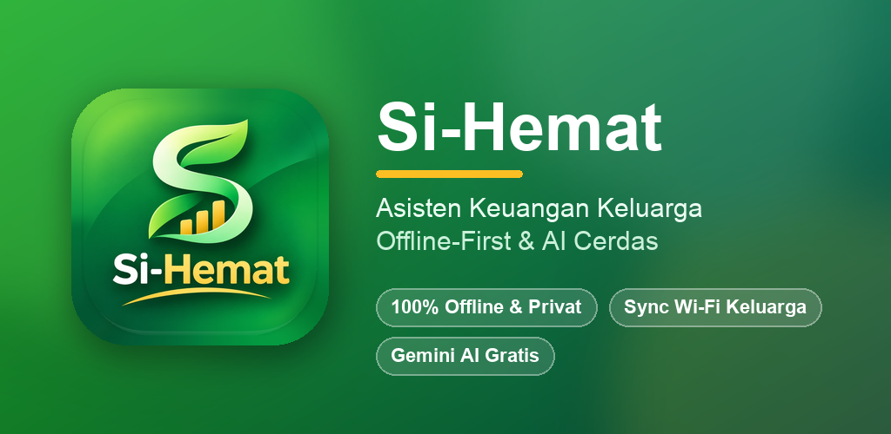

# Si-Hemat — Asisten Keuangan Keluarga Offline & AI

**Si-Hemat** adalah aplikasi pencatatan & laporan keuangan pribadi dan keluarga untuk Android yang **100% offline-first**, cepat, privat (tanpa server cloud pengembang), mendukung **sinkronisasi keluarga terenkripsi lewat Wi-Fi rumah**, serta dilengkapi **asisten Gemini AI opsional (GRATIS / BYOK)**.

---

## Unduh APK (Gratis via GitHub Releases)

👉 Unduh versi terbaru di **[Halaman Releases Si-Hemat](https://github.com/unang168/si-hemat/releases/latest)** lalu pilih file **`Si-Hemat-v1.1.1-arm64-v8a.apk`** (untuk sebagian besar HP Android modern 64-bit).

### Cara Install di HP Android
1. Unduh file `Si-Hemat-v1.1.1-arm64-v8a.apk` dari menu **Releases** di HP Android Anda.
2. Ketuk file APK hasil unduhan.
3. Jika Android menampilkan peringatan keamanan, pilih **Setelan / Settings** → aktifkan **Izinkan dari sumber ini (*Install unknown apps*)** untuk browser/File Manager Anda.
4. Ketuk **Install** dan buka **Si-Hemat**.

> **Catatan Update di Masa Depan:** Semua rilis resmi ditandatangani dengan *release keystore* yang sama sehingga saat ada versi baru (`v1.0.1`, `v1.1.0`, dst.), Anda cukup mengunduh dan meng-install APK baru langsung di atas versi lama **tanpa kehilangan data**.

---

## Fitur Utama

- **100% Offline & Privat:** Seluruh data disimpan lokal di SQLite perangkat Anda (tanpa wajib login, tanpa iklan, tanpa server pihak ketiga).
- **Mode Keluarga & Pribadi:** Pisahkan dompet & transaksi bersama keluarga dengan dompet pribadi Anda dalam satu aplikasi, lengkap dengan pemilih tampilan (`Semua | Keluarga | Pribadi`) di setiap tab.
- **Multi-Dompet & Transfer Akurat:** Kelola Kas, Bank, E-Wallet, dan Kartu Kredit dengan perhitungan saldo deterministik tanpa hitungan dobel saat transfer.
- **Safe-to-Spend Harian:** Menghitung batas belanja aman harian hingga tanggal gajian berikutnya (mendukung tanggal 1–31 / akhir bulan & otomatis maju ke Jumat jika jatuh di Sabtu/Minggu).
- **Anggaran Bulanan & Tagihan Rutin (+ Notifikasi HP H-2 & Hari-H):** Realisasi anggaran per kategori dengan drill-down transaksi, **notifikasi Android lokal saat aplikasi tertutup (2 hari sebelum & tepat hari jatuh tempo)**, serta dukungan tenor cicilan (menghentikan tagihan di bulan depan tetap menjaga riwayat lunas bulan-bulan sebelumnya).
- **Riwayat Cepat & Nyaman:** Format pemisah ribuan otomatis (`1.500.000`), subtotal harian, filter per dompet/jenis/anggota, kelola kategori kustom (24 ikon & 12 warna), dan geser (*swipe*) untuk hapus cepat dengan **Undo**.
- **Laporan Grafik Interaktif & Export:** Donut chart pengeluaran sentuh-interaktif, grafik batang arus kas 6 bulan dengan tooltip & sumbu Y, serta export **PDF & CSV**.
- **Sinkronisasi Wi-Fi Keluarga (Terenkripsi):** Pasangkan HP pasangan via Scan QR Code, lalu sinkronkan data bersama di Wi-Fi rumah yang sama dengan enkripsi **AES-256-GCM + HMAC-SHA256** (data bertanda *Pribadi* tidak pernah dikirim).
- **Asisten AI Fleksibel (BYOK — Gemini Gratis & 9Router):**
  - Mendukung **Google AI Studio (Gemini Free Tier)** maupun **9Router (OpenAI-compatible)** lengkap dengan muat daftar model/Combo otomatis (`/v1/models`).
  - Catat multi-transaksi lewat chat bahasa santai.
  - Scan foto struk / screenshot QRIS via multimodal vision.
  - Tanya evaluasi & saran hemat laporan bulanan.
- **Keamanan & Backup Terenkripsi:** Kunci PIN 6 digit + Biometrik (sidik jari) dengan *auto-lock* background, Mode Gelap/Terang/Sistem, serta Export/Restore penuh file terenkripsi **`.sihemat`** (PBKDF2 + AES-256-GCM).

---

## Privasi

Si-Hemat tidak mengumpulkan data pengguna apa pun. Lihat dokumen lengkap di [play_store/privacy-policy.html](play_store/privacy-policy.html).
